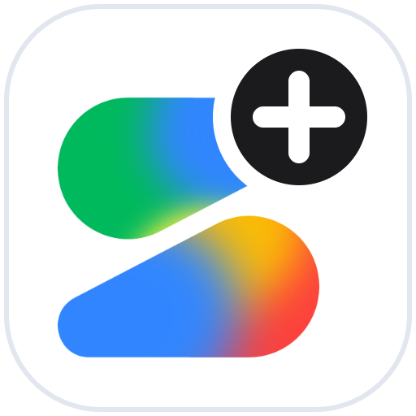
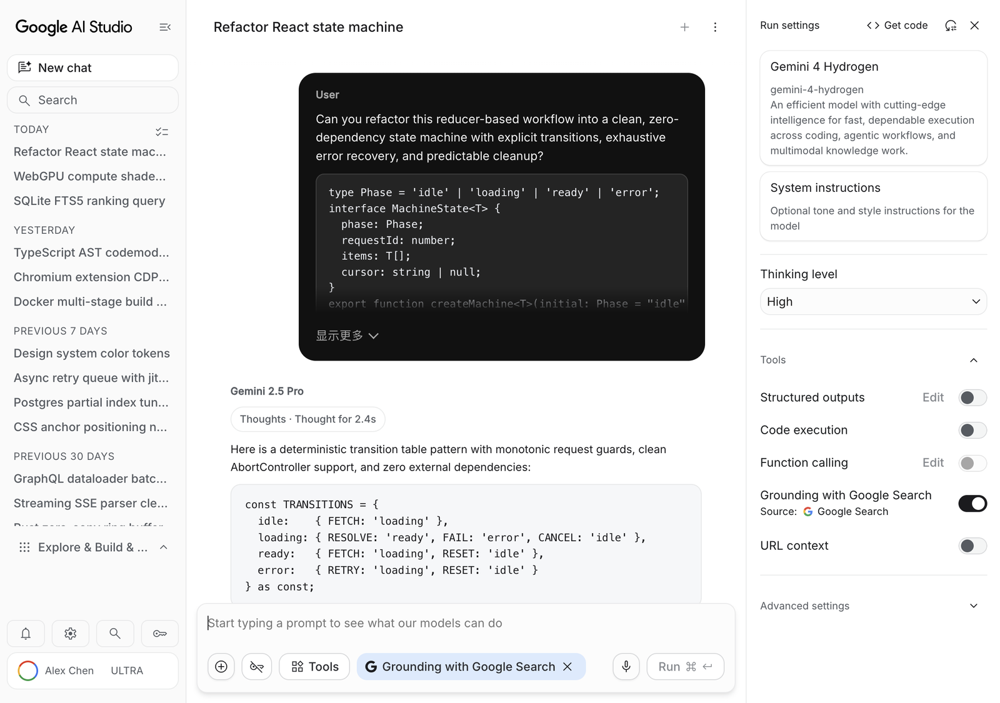
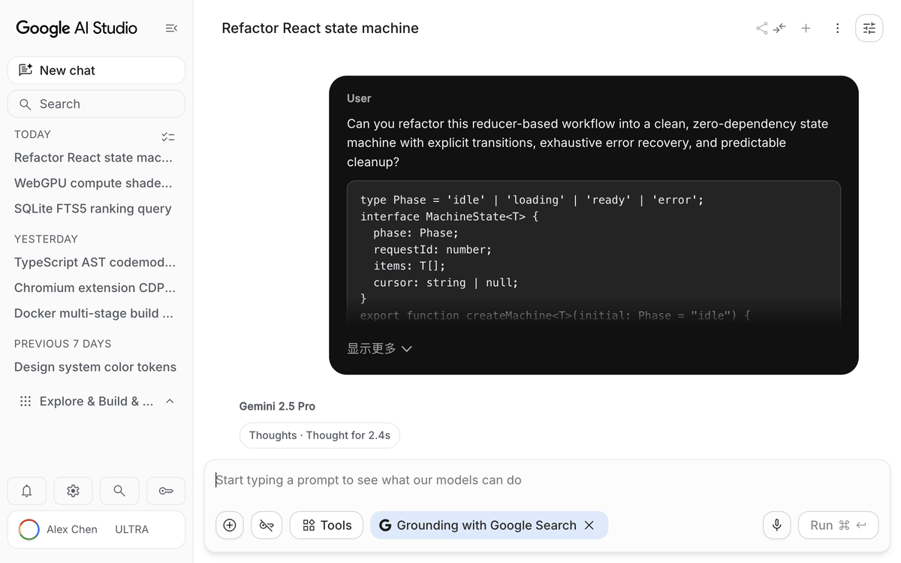
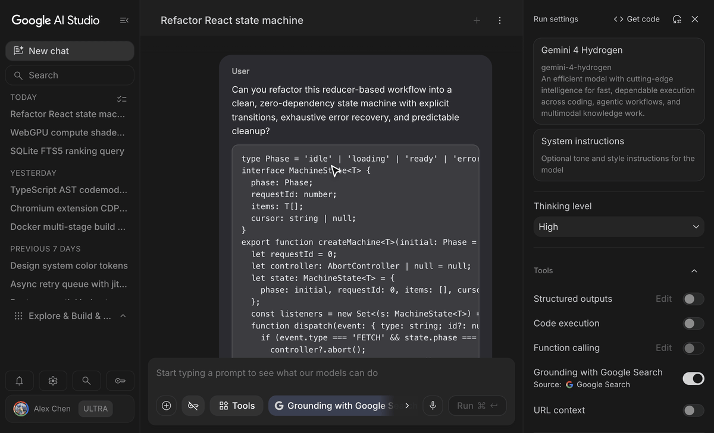

<div align="center">



<h1>AI Studio Plus</h1>

<p><strong>Turn Google AI Studio's left sidebar into an instant, searchable, multi-selectable chat workspace — with smart user bubble folding and GPU/battery optimizations.</strong></p>

<p>
  <a href="README.md"></a>
  <a href="README.zh-CN.md"></a>
</p>

<p>
  <a href="https://github.com/NonTrivialLiu/ai-studio-plus/actions/workflows/build.yml"></a>
  <a href="https://github.com/NonTrivialLiu/ai-studio-plus/releases/latest"></a>
  <a href="extension/manifest.json"></a>
  <a href="package.json"></a>
  <a href="extension/manifest.json"></a>
  <a href="LICENSE"></a>
</p>

<p>
  <a href="https://github.com/NonTrivialLiu/ai-studio-plus/releases/latest/download/AI-Studio-Plus-WebExtension.zip">
    
  </a>
</p>

<p>
  <sub>
    <a href="#live-demos">Live Demos</a> &nbsp;&bull;&nbsp;
    <a href="#features">Features</a> &nbsp;&bull;&nbsp;
    <a href="#installation">Installation</a> &nbsp;&bull;&nbsp;
    <a href="#shortcuts--gestures">Shortcuts</a> &nbsp;&bull;&nbsp;
    <a href="#privacy--security">Privacy</a> &nbsp;&bull;&nbsp;
    <a href="#contributing--license">Contributing</a>
  </sub>
</p>

<br />

<picture>
  <source media="(prefers-color-scheme: dark)" srcset="docs/assets/preview-dark.png" />
  <source media="(prefers-color-scheme: light)" srcset="docs/assets/preview-light.png" />
  
</picture>

<br />
<sub>Automatically matches your GitHub Light / Dark theme &mdash; seamless native Google AI Studio integration with zero visual clutter.</sub>

</div>

---

## Why AI Studio Plus?

Google AI Studio's default navigation tucks your recent prompts away on a separate History page, lacks quick sidebar actions, renders ultra-long user prompts uncollapsed, and uses heavy CSS `backdrop-filter` / transition animations that warm up laptops.

**AI Studio Plus** upgrades the entire workspace in-place across **Light & Dark themes** — with **zero extra permissions**, **zero background workers**, **zero npm runtime dependencies**, and **zero third-party servers**.

---

## Live Demos

<div align="center">

### 1. Infinite History, Instant Search, Multi-Select & Bubble Folding



<br />
<sub>Calendar-grouped history scroll, live multi-page search filtering, row context menu, multi-select trash bar, and long prompt folding in Light Mode.</sub>

<br /><br />

### 2. Dark Mode & Hover-to-Peek Sidebars with Pinning



<br />
<sub>Hover collapsed left navigation or right <em>Run settings</em> toggle to preview without shifting your prompt canvas — click the pin icon to lock open.</sub>

</div>

---

## Features

<table>
  <tr>
    <td width="50%" valign="top">
      <h3>&#x1F4C5; Native Infinite History Sidebar</h3>
      <p>Groups chats automatically by calendar day (<em>Today</em>, <em>Yesterday</em>, <em>Previous 7 days</em>, <em>Previous 30 days</em>, <em>Earlier</em>), streams older pages on scroll, and switches chats instantly without full page reloads.</p>
    </td>
    <td width="50%" valign="top">
      <h3>&#x1F50D; Instant Full-History Search</h3>
      <p>Filters loaded conversations as you type and transparently paginates older history in the background until matches appear or history ends.</p>
    </td>
  </tr>
  <tr>
    <td width="50%" valign="top">
      <h3>&#x26A1; Fast Inline &amp; Menu Actions</h3>
      <p>Click to open, double-click or press <code>F2</code> to rename inline (IME-safe), or use <code>&#x22EE;</code> / right-click for <strong>Rename</strong>, <strong>Share</strong> (native Google Drive dialog), <strong>Make a copy</strong>, <strong>Select</strong>, and <strong>Delete</strong>.</p>
    </td>
    <td width="50%" valign="top">
      <h3>&#x2611;&#xFE0F; Multi-Select &amp; Batch Trash</h3>
      <p>Long-press any row (<code>~500ms</code>) or click the list selection icon to batch-select chats across searches and move them to Trash in one guided flow.</p>
    </td>
  </tr>
  <tr>
    <td width="50%" valign="top">
      <h3>&#x1F4CC; Hover-to-Peek Sidebars &amp; Pin</h3>
      <p>Hover the collapsed left sidebar or right <em>Run settings</em> toggle to peek overlay panels without reflowing the editor; click the pin icon to lock open, or press <code>&#x2318;B</code> / <code>Ctrl+B</code>.</p>
    </td>
    <td width="50%" valign="top">
      <h3>&#x1F9E9; Compact Nav &amp; Extension Coexistence</h3>
      <p>Tucks <em>Explore / Build / Manage</em> into an expandable bottom drawer, removes promotional upsell cards, and coexists cleanly with extensions like Voyager.</p>
    </td>
  </tr>
  <tr>
    <td width="50%" valign="top">
      <h3>&#x1F4AC; Dark User Bubbles &amp; Folding</h3>
      <p>Right-aligned user prompt bubbles automatically collapse messages taller than <code>300px</code> into a clean <code>240px</code> fade-out preview with one-click expand/collapse.</p>
    </td>
    <td width="50%" valign="top">
      <h3>&#x1F50B; Battery, GPU &amp; Latency Relief</h3>
      <p>Removes overlay <code>backdrop-filter</code> blurs and universal CSS transition scans, skips off-screen history row paint via <code>content-visibility: auto</code>, scopes observers away from virtualized scrolling with passive scroll yielding, prevents narrow-viewport sidebar gap, and preconnects key origins at <code>document_start</code>.</p>
    </td>
  </tr>
</table>

---

## Installation

> Works on **Google Chrome**, **Microsoft Edge**, **Brave**, **Arc**, and other Chromium-based browsers on `aistudio.google.com` and `aistudio.google.cn`.

### Option 1: Download Prebuilt Release (Recommended)

1. Download the latest release archive: [**AI-Studio-Plus-WebExtension.zip**](https://github.com/NonTrivialLiu/ai-studio-plus/releases/latest/download/AI-Studio-Plus-WebExtension.zip).
2. Unzip it into a permanent folder on your disk *(keep this folder intact after loading)*.
3. Open your browser's Extensions page:
   - Chrome / Arc / Brave: `chrome://extensions`
   - Microsoft Edge: `edge://extensions`
4. Enable **Developer mode** (top-right toggle).
5. Click **Load unpacked** and select the extracted folder containing `manifest.json`.
6. Open or refresh [Google AI Studio](https://aistudio.google.com/).

### Option 2: Build from Source

Requires **Node.js &ge; 22** (zero runtime dependencies):

```bash
git clone https://github.com/NonTrivialLiu/ai-studio-plus.git
cd ai-studio-plus
npm run build
```

Then load the [`extension/`](extension/) directory via **Load unpacked** on `chrome://extensions`.

### Updating

Download and unzip the newest release over the same folder (or run `git pull && npm run build`), click **Reload (&#x21BB;)** on the **AI Studio Plus** card in `chrome://extensions`, and refresh AI Studio.

---

## Shortcuts & Gestures

| Action | Shortcut / Gesture |
|---|---|
| Toggle left sidebar | `⌘ + B` (macOS) / `Ctrl + B` (Windows/Linux) |
| Hover-preview collapsed sidebar / Run settings | Hover over the native toggle button (`300ms`) |
| Open chat in current tab | Click row |
| Open chat in new tab / window | `⌘ + Click` / `Ctrl + Click` / `Shift + Click` |
| Rename chat inline | Double-click row or press `F2` |
| Open row context menu | Click `⋮` button or right-click row |
| Enter multi-select mode | Long-press row (`~500ms`) or click selection icon |
| Cancel / Close menu, preview, or selection | `Esc` |

---

## Privacy & Security

- **Zero Permissions** — [`manifest.json`](extension/manifest.json) requests **no** extra `chrome.*` permissions.
- **Zero Background Workers** — No persistent background service worker; runs strictly on `aistudio.google.com` and `aistudio.google.cn`.
- **Zero Telemetry or External Servers** — Reuses your existing signed-in Google AI Studio session directly. Chat metadata (ID, title, timestamp) is cached only in your browser tab's `sessionStorage`.
- **Strict Trusted Types Compliant** — Built purely with native DOM APIs (`createElement` / `textContent`), zero `innerHTML`, and zero dynamic `eval`.
- Read the full [Privacy Policy](PRIVACY.md) for store compliance details.

---

## FAQ

<details>
<summary><strong>Does it work with Dark Mode and Light Mode?</strong></summary>
<p>Yes. All extension surfaces, borders, hover highlights, and semantic danger controls inherit AI Studio's theme tokens with matched <code>light-dark()</code> fallbacks.</p>
</details>

<details>
<summary><strong>Initial page load still feels slow behind a VPN &mdash; why, and what helps?</strong></summary>
<p>Browser profiling shows ~95% of initial load delay on VPNs comes from multi-domain RPC/CORS round-trips rather than CPU rendering. While AI Studio Plus preconnects high-latency origins at <code>document_start</code>, keeping a zero-permission design means it intentionally avoids spoofing private Google APIs. For the fastest startup behind a proxy: <strong>(1)</strong> pin all <code>*.google.com</code> / <code>*.gstatic.com</code> / <code>*.clients6.google.com</code> domains to a single low-latency HTTP/2 node, <strong>(2)</strong> set <code>www.googletagmanager.com</code> and <code>play.google.com</code> to <code>REJECT</code> instead of letting telemetry hang, and <strong>(3)</strong> keep disk caching enabled so <code>gstatic.com</code> JS bundles (~2 MB) stay cached.</p>
</details>

<details>
<summary><strong>Is Firefox supported?</strong></summary>
<p>Firefox 128+ supports Manifest V3 <code>MAIN</code> world content scripts, but Firefox behavior has not been formally tested yet. Chromium browsers are the primary supported target.</p>
</details>

<details>
<summary><strong>What if Google AI Studio updates its layout and the sidebar stops showing?</strong></summary>
<p>AI Studio Plus relies on Google AI Studio's internal DOM and RPC endpoints. If a site update changes them, please check <a href="https://github.com/NonTrivialLiu/ai-studio-plus/releases">Releases</a> for an update or <a href="https://github.com/NonTrivialLiu/ai-studio-plus/issues/new/choose">open a Bug Report</a>.</p>
</details>

---

## Contributing & License

Contributions, bug reports, and UI/UX suggestions are warmly welcome!

- Read [CONTRIBUTING.md](CONTRIBUTING.md) to set up local development, tests, and submit a Pull Request.
- Explore [docs/ARCHITECTURE.md](docs/ARCHITECTURE.md) for how the `MAIN` / `ISOLATED` scripts interact.

Licensed under the [MIT License](LICENSE).
