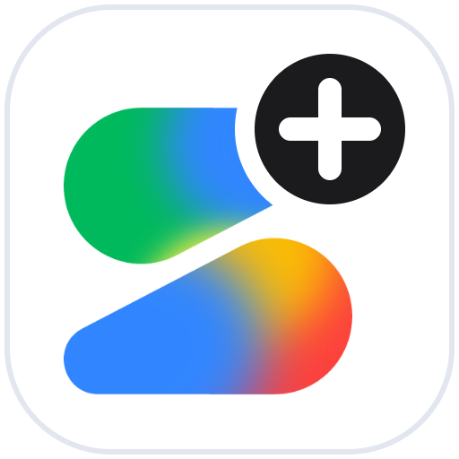
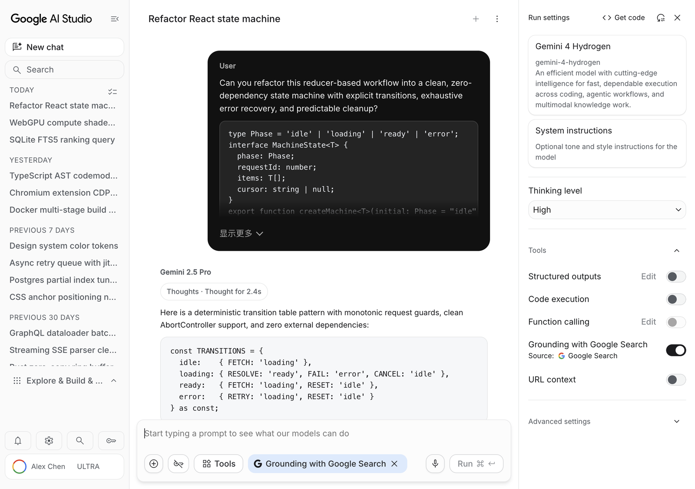
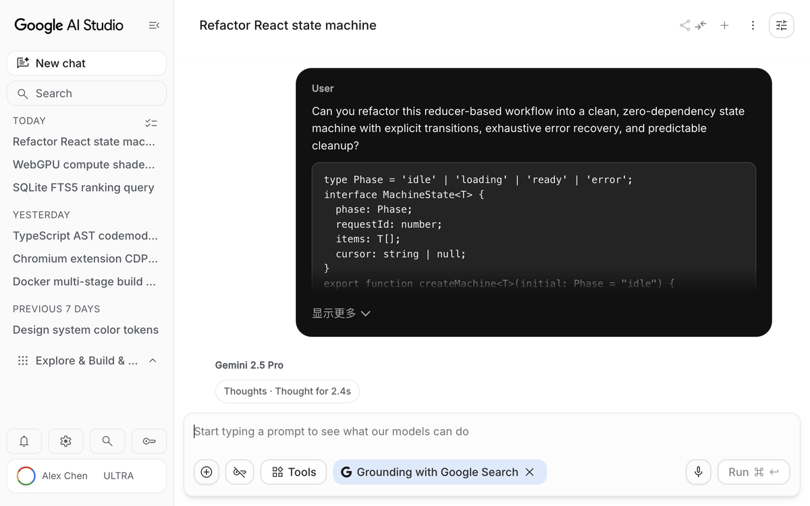
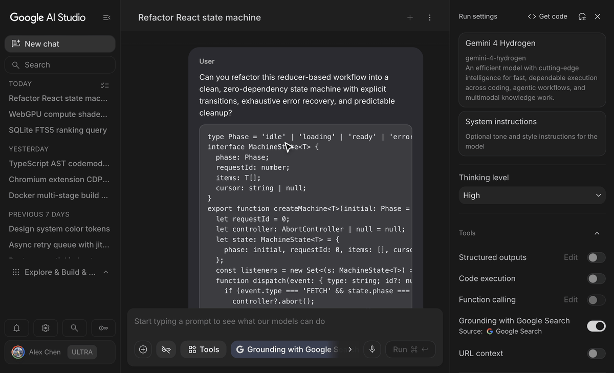

<div align="center">



<h1>AI Studio Plus</h1>

<p><strong>将 Google AI Studio 左侧栏升级为可搜索、可多选、无限滚动的原生会话工作区，并附带用户消息折叠与 GPU / 续航优化。</strong></p>

<p>
  <a href="README.md"></a>
  <a href="README.zh-CN.md"></a>
</p>

<p>
  <a href="https://github.com/NonTrivialLiu/ai-studio-plus/actions/workflows/build.yml"></a>
  <a href="https://github.com/NonTrivialLiu/ai-studio-plus/releases/latest"></a>
  <a href="extension/manifest.json"></a>
  <a href="package.json"></a>
  <a href="extension/manifest.json"></a>
  <a href="LICENSE"></a>
</p>

<p>
  <a href="https://github.com/NonTrivialLiu/ai-studio-plus/releases/latest/download/AI-Studio-Plus-WebExtension.zip">
    
  </a>
</p>

<p>
  <sub>
    <a href="#实机演示">实机演示</a> &nbsp;&bull;&nbsp;
    <a href="#核心功能">核心功能</a> &nbsp;&bull;&nbsp;
    <a href="#安装指南">安装指南</a> &nbsp;&bull;&nbsp;
    <a href="#快捷键与交互手势">快捷键</a> &nbsp;&bull;&nbsp;
    <a href="#隐私与安全承诺">隐私承诺</a> &nbsp;&bull;&nbsp;
    <a href="#参与贡献与开源协议">参与贡献</a>
  </sub>
</p>

<br />

<picture>
  <source media="(prefers-color-scheme: dark)" srcset="docs/assets/preview-dark.png" />
  <source media="(prefers-color-scheme: light)" srcset="docs/assets/preview-light.png" />
  
</picture>

<br />
<sub>随 GitHub 明暗主题自动切换预览 &mdash; 原生融入 Google AI Studio 设计体系，零冗余干扰。</sub>

</div>

---

## 为什么选择 AI Studio Plus？

Google AI Studio 原生侧栏默认不展示历史对话列表，查找或整理历史对话需要跳转到单独的 History 页面；长提问气泡占满屏幕，且大量毛玻璃与过渡动画在笔记本上容易拉高 GPU 功耗。

**AI Studio Plus** 以 **零额外权限**、**零后台常驻**、**零运行时依赖** 与 **零第三方服务器** 的方式，在完整保留原生明暗主题体验的前提下一次补齐上述能力。

---

## 实机演示

<div align="center">

### 1. 无限历史滚动、即时搜索、多选整理与长消息折叠



<br />
<sub>浅色主题下展示按日分组历史流、跨分页即时搜索、行操作菜单、批量回收站与用户长消息一键折叠。</sub>

<br /><br />

### 2. 深色主题与左右栏悬浮预览 / 图钉固定



<br />
<sub>左导航或右侧 <em>Run settings</em> 收起后，悬停切换按钮即可悬浮预览（不挤压对话宽度），点击图钉图标即可固定展开。</sub>

</div>

---

## 核心功能

<table>
  <tr>
    <td width="50%" valign="top">
      <h3>&#x1F4C5; 原生融合的无限历史流</h3>
      <p>按本地日历日自动分组（<em>Today</em>、<em>Yesterday</em>、<em>Previous 7 days</em>、<em>Previous 30 days</em>、<em>Earlier</em>），滚动触底自动加载更早记录，点击即站内切换，无需整页刷新。</p>
    </td>
    <td width="50%" valign="top">
      <h3>&#x1F50D; 全量历史即时搜索</h3>
      <p>输入关键词即时过滤已加载对话，并在后台自动翻页拉取更早记录，直到命中结果或拉取完毕。</p>
    </td>
  </tr>
  <tr>
    <td width="50%" valign="top">
      <h3>&#x26A1; 高效原位与菜单操作</h3>
      <p>单击切换、双击或按 <code>F2</code> 原位重命名（兼容中文输入法组字）；<code>&#x22EE;</code> 与右键菜单支持 <strong>Rename</strong>、<strong>Share</strong>（原生 Google Drive 面板）、<strong>Make a copy</strong>、<strong>Select</strong> 与 <strong>Delete</strong>。</p>
    </td>
    <td width="50%" valign="top">
      <h3>&#x2611;&#xFE0F; 多选与批量移入回收站</h3>
      <p>长按会话行（约 <code>500ms</code>）或点击列表顶部的选择图标进入多选；搜索过滤不丢勾选项，确认后逐项安全移入回收站。</p>
    </td>
  </tr>
  <tr>
    <td width="50%" valign="top">
      <h3>&#x1F4CC; 左右栏悬浮预览与固定</h3>
      <p>左侧导航或右侧 <em>Run settings</em> 收起时，悬停切换按钮即可临时覆盖预览而不挤压正文；点击图钉固定，或按 <code>&#x2318;B</code> / <code>Ctrl+B</code> 快捷开关。</p>
    </td>
    <td width="50%" valign="top">
      <h3>&#x1F9E9; 清爽底部抽屉与扩展共存</h3>
      <p>将 <em>Explore / Build / Manage</em> 收纳进可向上展开的底部抽屉，隐藏升级推广卡片，并与 Voyager 等其它扩展和谐共存。</p>
    </td>
  </tr>
  <tr>
    <td width="50%" valign="top">
      <h3>&#x1F4AC; 深色用户气泡与长消息折叠</h3>
      <p>用户消息右对齐呈现，高度超过 <code>300px</code> 时自动折叠为 <code>240px</code> 渐隐预览，一键展开或收起，并保留站点的离屏虚拟占位。</p>
    </td>
    <td width="50%" valign="top">
      <h3>&#x1F50B; GPU、续航与响应优化</h3>
      <p>定向切除浮层高开销 <code>backdrop-filter</code> 与全局通配样式重算，为历史列表行启用 <code>content-visibility: auto</code>，增量刷新与滚动让路屏蔽超长对话拖拽重排，消除窄屏侧栏残留空白并在 <code>document_start</code> 预热跨域连接。</p>
    </td>
  </tr>
</table>

---

## 安装指南

> 适用于 **Google Chrome**、**Microsoft Edge**、**Brave**、**Arc** 等 Chromium 内核浏览器，生效域名为 `aistudio.google.com` 与 `aistudio.google.cn`。

### 方式一：下载预打包发行版（推荐）

1. 下载最新发行压缩包：[**AI-Studio-Plus-WebExtension.zip**](https://github.com/NonTrivialLiu/ai-studio-plus/releases/latest/download/AI-Studio-Plus-WebExtension.zip)。
2. 将压缩包解压到一个**长期保留**的本地文件夹（加载后请勿删除该文件夹）。
3. 在浏览器地址栏打开扩展管理页：
   - Chrome / Arc / Brave：`chrome://extensions`
   - Microsoft Edge：`edge://extensions`
4. 打开右上角的 **开发者模式** 开关。
5. 点击 **加载已解压的扩展程序**，选择解压后包含 `manifest.json` 的目录。
6. 打开或刷新 [Google AI Studio](https://aistudio.google.com/) 即可生效。

### 方式二：从源码构建

需要 **Node.js &ge; 22**（零运行时依赖）：

```bash
git clone https://github.com/NonTrivialLiu/ai-studio-plus.git
cd ai-studio-plus
npm run build
```

随后在 `chrome://extensions` 中点击 **加载已解压的扩展程序** 并选择项目下的 [`extension/`](extension/) 目录。

### 如何更新

下载新版压缩包覆盖解压到原目录（或执行 `git pull && npm run build`），在 `chrome://extensions` 点击 **AI Studio Plus** 卡片上的 **刷新（&#x21BB;）** 按钮，然后刷新 AI Studio 页面即可。

---

## 快捷键与交互手势

| 操作 | 快捷键 / 手势 |
|---|---|
| 展开 / 收起左侧导航 | `⌘ + B`（macOS）/ `Ctrl + B`（Windows / Linux） |
| 临时悬浮预览左栏 / Run settings | 鼠标悬停原生开关按钮（`300ms`） |
| 当前标签页打开对话 | 单击会话行 |
| 新标签页 / 窗口打开对话 | `⌘ + 单击` / `Ctrl + 单击` / `Shift + 单击` |
| 原位重命名对话 | 双击会话行或按 `F2` |
| 打开行操作菜单 | 点击行尾 `⋮` 或右键点击会话行 |
| 进入多选模式 | 长按会话行（约 `500ms`）或点击选择图标 |
| 取消 / 关闭菜单、预览或退出多选 | `Esc` |

---

## 隐私与安全承诺

- **零额外权限** — [`manifest.json`](extension/manifest.json) 未申请任何 `chrome.*` 敏感权限。
- **零后台服务** — 无 Service Worker 常驻进程，仅在 `aistudio.google.com` 与 `aistudio.google.cn` 运行。
- **零遥测与外部通信** — 直接复用你在 Google AI Studio 的现有登录态；会话列表仅在当前标签页的 `sessionStorage` 中临时缓存 ID、标题和更新时间。
- **Strict Trusted Types 合规** — 全部界面严格使用原生 DOM API（`createElement` / `textContent`）构建，无 `innerHTML` 与动态 `eval`。
- 完整合规说明见 [隐私政策 (PRIVACY.md)](PRIVACY.md)。

---

## 常见问题

<details>
<summary><strong>是否适配浅色与深色主题？</strong></summary>
<p>支持。扩展的侧栏、浮层、边框、悬停态与删除危险色均复用 AI Studio 的主题变量，并配有对应的 <code>light-dark()</code> 深浅色兜底。</p>
</details>

<details>
<summary><strong>开启 VPN 后首次打开页面还是偏慢，有什么进一步提速建议？</strong></summary>
<p>真实性能采样显示，首次加载耗时 95% 来自跨域名 RPC 与 TLS 往返而非本地 CPU。插件已在 <code>document_start</code> 为关键端点补充 <code>preconnect</code> 预热，但为坚守「零权限、不伪造私有协议」的原则，不会强行拦截外部埋点域名。代理侧配合以下 3 点效果最明显：<strong>①</strong> 将 <code>*.google.com</code>、<code>*.gstatic.com</code>、<code>*.clients6.google.com</code> 固定在同一低延迟 HTTP/2 节点；<strong>②</strong> 对 <code>www.googletagmanager.com</code> 与 <code>play.google.com</code> 配置 <code>REJECT</code> 规则避免超时挂起；<strong>③</strong> 保留浏览器磁盘缓存，避免反复下载约 2 MB 的静态 JS。</p>
</details>

<details>
<summary><strong>是否支持 Firefox？</strong></summary>
<p>Firefox 128+ 已支持所需的 Manifest V3 <code>MAIN</code> 世界脚本，但目前尚未进行完整的 Firefox 实测与商店签名适配，当前主要维护与测试 Chromium 系列浏览器。</p>
</details>

<details>
<summary><strong>如果 Google AI Studio 改版导致侧栏不显示怎么办？</strong></summary>
<p>本扩展依赖站点的内部 DOM 结构与会话接口。如遇站点更新导致异常，可先到 <a href="https://github.com/NonTrivialLiu/ai-studio-plus/releases">Releases</a> 查看是否有新版更新，或直接提交 <a href="https://github.com/NonTrivialLiu/ai-studio-plus/issues/new/choose">Bug Report</a>。</p>
</details>

---

## 参与贡献与开源协议

欢迎提交 Issue、交互建议与 Pull Request！

- 开发者环境搭建、代码规范与提交流程请阅读 [CONTRIBUTING.md](CONTRIBUTING.md)。
- 核心架构与模块边界说明见 [docs/ARCHITECTURE.md](docs/ARCHITECTURE.md)。

本项目基于 [MIT License](LICENSE) 开源。
